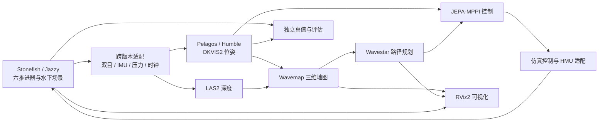

# Pelagos 水下仿真平台方案

> 历史方案：后续已开始实现 Stonefish、OKVIS2、LAS2-S 和 RViz 适配，实际目录与命令以 [README](README.md) 为准。实现采用同一 Jazzy 仿真容器，不采用本文原拟的跨版本桥；本文的导航控制方案仍属规划，不能代表已完成验收。

## 1. 目标与推荐方案

在 `Pelagos/Simulation` 建立 Pelagos 的仿真入口，复用本机 **Stonefish + 六推进器 BlueROV2 + ROS 2**，逐步接通 Pelagos 实际使用的 **OKVIS2 → LAS2 → Wavemap → Wavestar → JEPA-MPPI**，用 RViz2 观察机器人、估计轨迹、地图和规划路径，并支持记录、回放和评估。

第一版先完成有纹理的测试场景与短距离目标导航；Porth 洞穴、浑浊水体和批量试验在基础链路稳定后接入。优先使用现有工作区提供的模型、场景、守护和验证逻辑，Pelagos 自己只增加仿真编排、传感器适配、控制适配、配置和评估。

## 2. 本机资产清单

| 资产 | 已发现内容 | 处理方式 |
| --- | --- | --- |
| [MY_Stonefish_ws/stonefish_slam_ws](/home/hong/Desktop/MY_Stonefish_ws/stonefish_slam_ws/README.md) | Stonefish、BlueROV2、六推进器配置、空水/有纹理测试场景、Porth 入口、ROS 2 与 Docker 配置；其 Dockerfile 使用 **ROS 2 Jazzy**。项目 README 记载过六通道和导航历史测试。 | 作为首选仿真基础；引用其资源，记录实际版本，先检查当前环境能否启动。 |
| [Porth 资产](/home/hong/.local/share/stonefish-slam/assets/porth_sump9_v1/asset.json) | 本机存在洞穴模型和路线；按现有资源锁核对，17/17 文件的大小和 SHA-256 匹配。 | 初期只读引用；按运行配置单独核对资产路径及来源锁。 |
| [Pelagos](/home/hong/Desktop/Pelagos/README.md) | 工程目标环境为 **ROS 2 Humble**，包含 OKVIS2、LAS2、Wavemap、Wavestar、JEPA-MPPI、ROS 接口和 RViz 配置；LAS2 权重及控制器 checkpoint 在项目中。当前项目目录未发现 `install/okvis2` 和 `venv-las2`。 | 作为被测系统，在 Humble 运行环境中构建依赖，仿真使用独立配置，避免改写真机标定。 |
| [控制器采集代码](/home/hong/Desktop/Pelagos/TP/Controller/disaware_learning/collection/physics_domain.py) | 包含六推进器物理域、扰动和数据记录代码；另有低阶水动力代理。 | 复用参数与实验工具；代理只用于快速筛查，不代表 Stonefish 物理结果。 |
| [HMU 协议模拟器](/home/hong/Desktop/Pelagos/TP/Controller/hmu_bridge/hmu_bridge/simulator.py) | 能接收协议命令并发送构造的遥测。 | 可用于协议单测；它当前不会根据命令驱动 Stonefish，也不会返回真实仿真状态，需要另做闭环适配。 |
| [stonefish_runs](/mnt/data8t/stonefish_runs/PIPELINE.md) | 既有水下视觉实验、Stone/Coral 场景记录和 OKVIS2 结果。其传感器配置与当前 Pelagos 不同。 | 后续用作离线视觉与定位对照，先核验各记录的标定、数据格式和时间；不直接当作本平台的在线闭环结果。 |

检查环境时，本次执行环境中可以看到 Ubuntu 24.04、Docker 客户端和 NVIDIA PCI 设备，但无法访问 Docker daemon，`nvidia-smi` 无法连接驱动，`/opt/ros` 不可见。这些现象可能是当前执行环境的隔离限制，**不能据此断定宿主机没有 Docker、GPU 或 ROS**；需要在实际运行平台的桌面会话中做一次环境检查。

## 3. 平台结构



默认仿真使用独立 ROS 域和明确的 `simulation` 配置，控制出口只能连接本地仿真终端；不调用部署目录中带 SSH、真机地址或 systemd 真机服务的启动脚本。ROS 域只能减少话题干扰，不能单独保证网络隔离，因此控制适配还需限制目标地址并拒绝真实设备配置。

为便于逐层排障，设计三种模式：

1. **观察模式**：启动场景、双目、IMU、可视化和记录；推进器未授权。
2. **感知/建图模式**：使用传感器运行 OKVIS2、LAS2、Wavemap，允许回放已保存的数据；无需导航运动。
3. **闭环导航模式**：在前两层通过后启动规划、控制和六推进器；显式授权本次仿真运动。

## 4. 关键接口与必须补齐的适配

### 4.1 ROS 版本与通信

现有 Stonefish Dockerfile 和入口使用 Jazzy，Pelagos 的部署脚本使用 Humble。推荐保留现有 Jazzy 仿真容器，在独立的 Ubuntu 22.04/Humble 环境中运行 Pelagos，两边各放一个专用适配进程，通过本机有界传输交换数据。优先评估复用 [Pelagos 的长度分帧工具](/home/hong/Desktop/Pelagos/Deployment/contracts/wire.py)：它只是通用传输积木，不是已经实现的跨版本 ROS 桥。传感器桥需要明确消息类型、时间戳、坐标帧、编码、图像负载及版本；单独的控制通道需要命令序号、有效期、确认和断链归零。两侧使用独立 ROS 域，只有指定数据进入对端。

Jazzy 侧保留原生推进器守护及其授权逻辑，跨版本控制适配只向该终端请求仿真动作，不直接绕开守护。Humble 侧发布接收到的 `/clock`、双目、IMU 和压力，生成 Pelagos 使用的消息；真值进入独立评估通道。图像队列要有界，控制消息不能被图像阻塞。按 640×480、RGB8、双目 20 Hz 计算，原始图像负载约 36.9 MB/s，不含协议开销；实际速率和内存需在本机测量。

可以先做一项小范围试验，检查当前版本和消息是否能直接通过 DDS 互通；只有完整通过时间戳、数据、QoS、断连和负载测试后才考虑简化为直接通信。不要仅因能够发现话题就假设跨版本可靠。备选路线是将仿真组件重新构建到 Humble，但涉及现有 Jazzy 依赖和补丁，需单独评估，不作为第一版前提。

### 4.2 双目、IMU 和标定

现有六推进器机器人继承的相机配置为 **640×480、基线 0.145 m**；Pelagos 当前真机配置为 **960×600、基线约 0.12016 m**，还有真实相机畸变、相机/IMU 外参及 8.7 ms 时间补偿。两套标定不能混用。为现有仿真相机生成独立的 OKVIS2、LAS2 和地图配置，以仿真场景实际的相机模型、内外参、图像尺寸、时间偏移和 IMU 模型为准；由投影与深度尺度测试确认，再冻结到每次运行记录中。若之后需要模拟真机原始成像，应额外实现与验证畸变和噪声，不能仅改话题名或缩放图片。

| 数据 | 现有仿真工作区示例 | Pelagos 当前接口 | 需要做的事 |
| --- | --- | --- | --- |
| 左右彩色图 | `/rov01/sensors/stereo/{left,right}/image_raw` | `/zed/zed_node/{left,right}/color/raw/image` | 转换或映射到兼容编码、正确光学坐标帧，并使用仿真标定。 |
| 左右灰度图 | 同一对彩色输入 | `/zed/zed_node/{left,right}/gray/raw/image` | 生成灰度图；保持对应图像采集时间戳。 |
| IMU | `/rov01/sensors/imu` | `/zed/zed_node/imu/data_raw` | 核对 FRD/FLU、单位、重力和 specific force、外参、噪声及实际频率。 |
| 压力 | 某些 M2/JEPA 配置会创建 `/rov01/sensors/pressure` | 控制运行时经 HMU 遥测读取深度 | 检查所选场景确实启用了压力传感器，并按水密度、零压和单位转换；没有时明确报错。 |
| 真值 | `/rov01/sim/ground_truth/odometry` | 仅评估使用 | 独立保存并进行误差评价，不作为正式定位或控制输入。 |

具体话题和命名空间以启动后的 ROS 图核验。LAS2 使用严格双目时间同步，适配层必须保证同一采集时刻的左右图时间戳一致，同时检查 QoS、`CameraInfo` 和图像编码。目前 LAS2 节点还固定检查真机光学帧名，仿真接入需要在独立配置中参数化该检查，或在确认变换完全一致后适配帧名。测试场景检查棋盘投影、左右相机方向及多距离深度尺度，不能仅以节点能启动作为通过标准。

### 4.3 坐标与时间

- Stonefish 工作区配置注明内部世界/机体使用 NED/FRD，公开适配使用 ENU/FLU。复用现有转换并核对姿态、速度、协方差、相机 optical frame 和 IMU 安装外参；避免重复转换。现有观察适配器会把真值同时发布到 `state/odometry` 和 TF，正式运行需选择只发布传感器的输入链路，由估计器提供状态和 TF；真值路径不发布同名 TF。
- 仿真链路统一一个 `/clock`，需要的 ROS 节点启用 `use_sim_time`，并检查每个算法确实接受该时钟。回放时由播放器发布 `/clock`，不能与在线仿真同时发布。
- 当前 [控制运行时](/home/hong/Desktop/Pelagos/Deployment/contexts/control/services/runtime.py) 使用 `time.time()`、跨主机时钟对齐及 HMU 遥测时效检查；仅设置 `use_sim_time` 不足以接通仿真。需要明确注入时钟：传感器及地图的时间一致性用仿真时间，通信超时和守护用单调墙钟；暂停、恢复、重置、时间倒退时清空失效历史并撤销运动，分别验证。

### 4.4 规划与控制闭环

1. 先复用 Pelagos 的 Wavemap 数据源、`robot_bridge` 和 `wavestar_host` 组合，验证能生成地图、路径、`/planning/execution_reference` 和带会话/地图版本的规划缓存。现有原生导航节点可发布 `/planning/path`，但控制器还要求 execution reference 与对应的规划地图；不能认为有一条路径就已接好控制。若改用其他规划入口，需补齐相同语义并验证地图版本与路径时效。
2. 仿真端实现与现有控制运行时契约兼容的 HMU 适配：提供基于仿真状态的遥测和深度，接收控制提议，记录实际被仿真终端接受的命令及推进器反馈。可复用现有协议解码与控制门控，但不能把固定波形的 MockRovServer 当作动力学反馈。
3. 按 [Pelagos 六通道契约](/home/hong/Desktop/Pelagos/Deployment/contexts/control/core/motor_contract.py) 显式映射模型顺序 `FrontRight, FrontLeft, BackRight, BackLeft, DiveRight, DiveLeft` 与厂商通道 `R1, L1, R3, L3, R2, L2`，使用配置中的方向；`L4/R4` 保持中位。仿真推进器的 `inverted` 和厂商电机符号必须以逐通道正反向和组合运动验证，不能只凭名称认定方向。
4. 将输出接入现有 Stonefish 终端及其授权、超时和归零机制。状态历史记录实际成功发送/接受的指令；原生命令与推进器响应分别记录，不把指令值当成实测推力。断链、过期、停止和故障时均验证中位输出。

初始调试可以标注使用 `PRIVILEGED_DEBUG` 的真值状态来检查模型和控制接口；正式闭环指标必须使用 OKVIS2 等传感器估计，真值仅供独立评价。现有某些演示配置使用真值或 OpenVINS，因此历史演示成功不能直接证明 Pelagos 闭环已完成。

## 5. 建议目录与使用方式

以下是**拟议结构**，当前尚未创建这些组件：

```text
Simulation/
├── 仿真平台方案.md
├── README.md                  # 环境、场景、命令与排障
├── .gitignore                 # 排除运行记录和录包
├── sim                        # 拟议的统一入口
├── config/
│   ├── platform.yaml          # 仿真资源路径、ROS 域、运行配置
│   ├── sensors/               # 仿真专用标定与传感器参数
│   ├── robots/                # 六推进器映射、几何、限幅
│   └── scenarios/             # 测试房间、Porth 与水体预设
├── adapters/                  # Jazzy/Humble 桥及传感器、规划、控制边界
├── launch/                    # Stonefish 和 Pelagos 的组合启动
├── evaluation/                # 轨迹、深度、地图与任务评估
└── runs/                      # 每次运行的独立输出，不纳入版本管理
```

拟议入口（**仅为接口设计，现阶段不可执行**）：

```bash
./Simulation/sim doctor
./Simulation/sim start --scene visual_fixture --mode observe
./Simulation/sim start --scene visual_fixture --mode mapping
./Simulation/sim start --scene visual_fixture --mode navigation
./Simulation/sim start --scene porth --mode navigation
./Simulation/sim replay --run <run_id>
./Simulation/sim evaluate --run <run_id>
./Simulation/sim stop
```

每次运行单独生成 `manifest.json`、配置与标定快照、场景和模型来源哈希、进程日志、任务结果和评估报告；可选录制 rosbag。默认只记录状态和指标；需要传感器回放时显式录制双目、IMU、标定和时钟，并设置时长、磁盘配额和停止条件。现有仿真工作区给出的全量 debug bag 参考体积约 3.3 GB/分钟，实际空间消耗要以选中的话题、分辨率和压缩方式实测。

## 6. 分阶段实施与验收

以下数值为建议的首轮验收目标，需结合本机帧率、场景和实际误差调整并在测试前固定；不是目前已测结果。

| 阶段 | 交付 | 验收方式 |
| --- | --- | --- |
| 0. 环境与资产 | 检查 Jazzy 仿真镜像、Humble 构建依赖、GPU、图形会话、磁盘空间和 Porth 资源；记录来源版本。 | 能从现有入口启动六推进器场景；记录实际镜像 ID 和各依赖，缺失项明确报错。 |
| 1. 传感器与标定 | 观察模式、跨版本传输和适配器、仿真专用标定、RViz。 | 连续运行 60 秒，核对跨桥图像内容、时间戳和坐标；左右时间戳成对，IMU/图像/时钟持续更新；棋盘投影误差目标 <1 像素，多距离几何深度尺度误差目标 <5%；坐标和重力方向通过已知姿态检查。另做满负载和断连测试，记录帧率、延迟、丢帧与内存。 |
| 2. 感知与建图 | OKVIS2、LAS2、Wavemap、记录与回放。 | 在有纹理场景通过受控的短距离仿真运动完成至少一次 60 秒传感器驱动的轨迹，位姿和地图连续输出；同次记录可回放；保存对齐方式明确的轨迹误差、LAS2 深度误差和建图结果。 |
| 3. 规划与控制 | Wavestar、JEPA-MPPI、仿真 HMU、推进器接口、手动目标。 | 六通道正反向及归零检查通过；在已观测空间完成至少 3 次独立的 0.5–1 m 目标试验，无碰撞，记录终点误差、耗时和推力命令；断链/时钟暂停/目标失效时验证停机。 |
| 4. 洞穴与实验 | Porth 短程、水体变化、批量运行与报告。 | 对同一固定起点和目标重复实验，保存配置、种子和失败原因；分别报告定位误差、导航成功率、碰撞、终点误差、实时率和资源消耗。 |

第 0 阶段若环境正常，阶段 1–3 预计约 **12–25 个工作日**，阶段 4 另需约 **2–4 个工作日**。这只是单人粗估；具体耗时取决于 Docker/GPU 可用性、Humble 依赖构建、跨版本传输、传感器标定及现有控制接口适配情况。

## 7. 先做什么

第一步在实际桌面环境确认 `docker version`、`docker image inspect stonefish-slam:actuators`、`nvidia-smi`、图形会话和可用空间，并核对 Porth 的锁文件；然后使用现有工作区的 `actuators` profile 运行观察场景，检查 `/clock`、双目和 IMU。再选择启用压力传感器的配置，并在独立的六通道诊断中检查推进器与归零。此步骤通过后，再从 `Simulation` 目录接入 Pelagos 的仿真标定和传感器适配，逐层推进到闭环。
